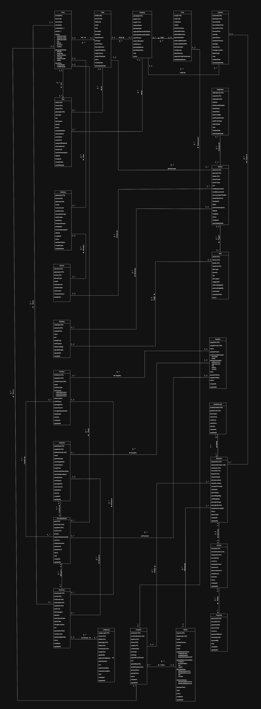

# 🌱 AgriFusion Database management

A MySQL database project designed to manage agricultural operations and information.

## Features
- Farm and field management
- Crop planting and harvesting
- IoT sensor monitoring
- Fertilizer and pesticide inventory
- Suppliers and purchase orders
- Buyers, shipments, and payments

## Database Structure

- The database uses:
- Primary Keys (PK)
- Foreign Keys (FK)
- Data types and constraints
- Relational table structures

## Technologies used
- MySQL
- SQL

## Database Structure
The database contains 26 relational tables connected using primary and foreign keys.

## How to Run
1. Open MySQL Workbench.
2. Open `agriFusion.sql`.
3. Execute the SQL script.

## Entity Relationship Diagram (ERD)

The following diagram illustrates the structure of the AgriFusion database, including its entities and relationships.

